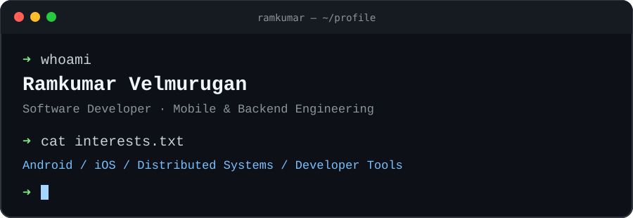
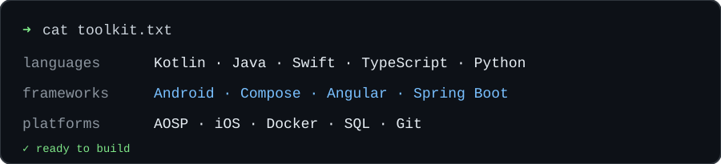

  

I build mobile apps, backend services, and developer tools. My background includes Android platform development, iOS, authentication systems, and distributed software.

I enjoy getting ideas into working prototypes, understanding how systems behave under the hood, and making software that people can actually use.

### A little about my work

- **Mobile:** Android, AOSP, Jetpack Compose, and iOS development.
- **Backend:** APIs, authentication, Spring Boot, and distributed systems.
- **Currently exploring:** AI-assisted development, developer productivity, and new approaches to software architecture.

### Toolkit

  

### Find me online

[Website](https://spkdroid.com) · [GitHub](https://github.com/spkdroid) · [LinkedIn](https://www.linkedin.com/in/vrk1990/) · [Email](mailto:vrk1990@outlook.com)

---

*“Somewhere, something incredible is waiting to be known.”* — Carl Sagan
